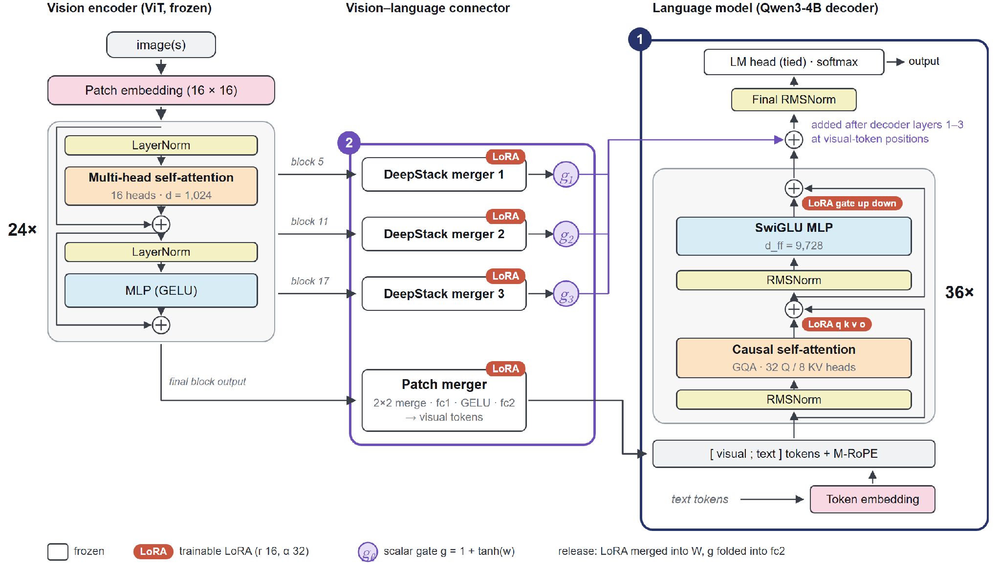

# 반복 루프 구간 선호 학습을 통한 Qwen3-VL-4B의 MMMU 성능 개선

**9조 두 번 말하게 하지마** · 김진우 · 김선재 · 안영찬 · 윤희성 · 2026 Fall 멀티모달 딥러닝 팀 프로젝트

Qwen3-VL-4B-Instruct가 MMMU에서 같은 문장을 반복하다 답을 내지 못하는 문제를 발견했고, 루프가 시작된 구간만 비선호로 학습하는 **Loop-Segment DPO**로 이를 줄였다. 최종 모델 **DPO-ERA**는 MMMU val **64.00% → 67.44%**, test **61.61% → 65.89%**, MMMU-Pro **52.60% → 54.68%**를 기록했다.

## 목차
1. [문제 정의](#1-문제-정의)
2. [방법](#2-방법)
3. [데이터 수집](#3-데이터-수집)
4. [결과](#4-결과)
5. [Ablation](#5-ablation)
6. [실패 분석](#6-실패-분석)
7. [교훈과 한계](#7-교훈과-한계)
8. [재현 방법](#8-재현-방법)
9. [저장소 구성](#9-저장소-구성)

## 1. 문제 정의

**베이스라인.** Qwen3-VL-4B-Instruct [1] (revision `ebb281e`)를 과제 평가 harness로 MMMU val 900문항 [2]에 평가했더니 64.00%였다(공식 보고치 67.4 [1]). 설정은 vLLM 0.11.0 [3], T 0.7 · top-p 0.8 · top-k 20 · presence penalty 1.5, 출력 상한 32,768 tokens, seed 3407이다. "Final answer:" 줄을 파싱하고, 실패하면 Qwen3-8B judge가 채점한다. → [베이스라인 보고서](assignment/assignment1.md)

**오답 324건을 직접 읽고 유형을 나눴다.**

| 유형 | 건수 | 내용 |
|---|---:|---|
| **T 잘림** | **81 (25%)** | 32,768 tokens까지 생성하고도 답이 없음, 전부 오답 |
| C 개념·조건 적용 | 76 | 공식·개념·조건을 잘못 적용 |
| U 근거 불명확 | 48 | |
| I 대상 식별 | 46 | 그림 속 대상·구조·소견을 잘못 알아봄 |
| V 시각 정보 해석 | 29 | 수치·라벨·위치를 잘못 읽음 |
| 기타 (R · D · N · P) | 44 | |

**잘림의 원인은 반복 루프였다.** 81건 대부분이 같은 문장을 되풀이하다 상한에 걸렸고, 이 81건이 전체 생성 토큰의 72.9%를 차지했다. 예를 들어 Physics_29는 응답의 9% 지점부터 *"Wait — in a diamond, the two diagonal nodes are connected by two resistors … that doesn't make sense."*를 185번 반복했다. 루프 전까지는 정상적으로 풀고 있었으므로, **루프 진입만 막으면 회복할 수 있는 문항**이라고 봤다. 반복은 한번 시작되면 스스로 강화된다는 선행 연구와도 같은 현상이다 [4, 5].

베이스 모델은 공식 리포트 [1]상 SFT, 증류, 강화학습(SAPO)까지 거쳤고 반복 억제도 따로 학습했다. 그래도 남은 이 잔여 루프를, GPU 한 장으로 돌릴 수 있는 offline 선호 학습으로 고치는 것이 목표였다.

나머지 C · I · V 151건은 풀이의 서로 다른 단계(근거 읽기 · 규칙 연결 · 적용)에서 틀린 경우라, ERA(Evidence → Rule → Application) 형식 풀이와 시각 연결부 학습으로 함께 다뤄 보기로 했다.

## 2. 방법

### Method Overview



Qwen3-VL-4B-Instruct의 구조는 그대로 두고 두 부분만 학습한다. 시각 인코더(ViT)는 고정한다.

- **① Main · Loop-Segment DPO:** language model(decoder 36층)의 attention(q·k·v·o)과 MLP(gate·up·down)에 LoRA를 달아 학습한다 [18]. 루프 쌍 326개로 DPO를 학습하며, 같은 문항의 정답 응답은 선호하고 루프 응답은 루프 시작 후 512 tokens 구간만 비선호로 계산해 루프 생성 확률을 낮춘다.
- **② Auxiliary:** 시각 특징이 language model로 전달되는 connector(patch merger, DeepStack merger 3개)에 LoRA와 DeepStack gate g = 1 + tanh(w)를 달아, 이미지 특징을 전달하는 세기를 함께 학습한다 [16]. 데이터로는 ERA 형식 정답 풀이 선호 703쌍과 기존 정답 보존용 300개를 더한다.
- 학습이 끝나면 LoRA와 gate를 원래 가중치에 합쳐서(gate는 fc2에 흡수), 평가 모델 구조는 베이스라인과 같다.

### ① Main · Loop-Segment DPO
같은 문항에서 모델이 쓴 **정상 종료 정답(y⁺)은 선호**하고, **루프 응답(y⁻)은 루프가 시작된 뒤 512 tokens만 비선호**로 학습한다. 루프 앞의 정상 풀이는 문맥으로만 들어가고 손실에서는 빠진다. 정답 확률이 같이 떨어지지 않도록 정답 NLL을 더한다 [9, 13, 14].

<details>
<summary><b>DPO의 원리 (수식 전개)</b></summary>

**1. 목표.** 보상 r은 높이되 학습 전 모델 π_ref에서 너무 멀어지지 않게 한다 (RLHF와 같은 목표, DPO [13]).

$$\max_{\pi}\ \mathbb{E}_{y\sim\pi}[r(x,y)] - \beta\,\mathrm{KL}\big(\pi\,\|\,\pi_{\text{ref}}\big)$$

**2. 최적해.** 이 문제의 해는 닫힌 형태로 나온다.

$$\pi^*(y|x) = \frac{1}{Z(x)}\,\pi_{\text{ref}}(y|x)\,\exp\!\big(r(x,y)/\beta\big)$$

**3. 보상을 확률비로 바꿔 쓰기.**

$$r(x,y) = \beta\log\frac{\pi^*(y|x)}{\pi_{\text{ref}}(y|x)} + \beta\log Z(x)$$

**4. 쌍 비교 모델(Bradley–Terry)에 넣으면 Z(x)가 사라진다.**

$$P(y^+\succ y^-) = \sigma\big(r(x,y^+) - r(x,y^-)\big)
= \sigma\Big(\beta\Big[\log\tfrac{\pi_\theta(y^+|x)}{\pi_{\text{ref}}(y^+|x)} - \log\tfrac{\pi_\theta(y^-|x)}{\pi_{\text{ref}}(y^-|x)}\Big]\Big)$$

**5. DPO 손실.** 이 확률의 음의 로그를 최소화한다. 보상 모델도, 학습 중 생성도 필요 없다.

$$\mathcal{L}_{\text{DPO}} = -\log\sigma\big(\beta(\Delta^+ - \Delta^-)\big),\qquad \Delta = \log\pi_\theta - \log\pi_{\text{ref}}$$

**6. 우리가 바꾼 두 가지.**
- 루프 응답은 루프 시작 t₀ 이후 512 tokens만 계산한다: $\Delta^- = \sum_{t\in W}\big[\log\pi_\theta(y^-_t|x,y^-_{<t}) - \log\pi_{\text{ref}}(y^-_t|x,y^-_{<t})\big]$, $W=[t_0,t_0+512)$
- 정답 확률이 같이 떨어지지 않도록 정답 NLL을 더한다: $\mathcal{L} = \mathcal{L}_{\text{DPO}} + \lambda\,\mathrm{NLL}(y^+)$

**7. 기울기의 의미.**

$$\nabla_\theta\mathcal{L}_{\text{DPO}} = -\beta\,\sigma(-z)\big[\nabla\Delta^+ - \nabla\Delta^-\big],\quad z=\beta(\Delta^+-\Delta^-)$$

아직 구분을 못 하는 쌍일수록(σ(−z)가 클수록) 크게 학습하고, 정답 토큰의 확률은 올리고 루프 구간 토큰의 확률만 내린다. W 밖의 토큰은 기울기가 0이라 루프 앞의 정상 풀이는 건드리지 않는다.

</details>

```
L = −log σ( β [ log πθ(y⁺|x)/πref(y⁺|x) − Σ_{t∈W} log πθ(y⁻_t|x,y⁻_<t)/πref(y⁻_t|x,y⁻_<t) ] ) + λ·NLL(y⁺)
W = [t₀, t₀+512),  β = 0.1,  λ = 1.0,  πref = 학습 전 모델 (LoRA off)
```

| 선행 연구 | 가져온 것 |
|---|---|
| DPO [13] | 보상 모델 없이 쌍으로 직접 학습 |
| Step-DPO [9] | 틀린 구간에만 선호 학습 → 루프 시작 후 512 tokens만 비선호 |
| Iterative RPO [14] | 모델 자신의 응답으로 쌍 구성 + 정답 NLL |
| Unlikelihood [10] · Break the Loop [5] | 반복은 스스로 강화되므로 시작 직후를 억제 |

### ② Auxiliary (DPO-ERA에서 추가)
- **ERA 선호 쌍 703개:** ERA 형식으로 맞힌 풀이 ≻ 베이스 오답
- **보존 replay 300개:** 원래 잘 풀던 문항의 풀이를 따라 쓰기 (NLL만) [17]
- **Connector LoRA + DeepStack gate:** 시각 특징이 language model로 넘어가는 patch merger · DeepStack merger 3개에 LoRA, 주입 세기 g = 1 + tanh(w) [16]
- **이미지 조건 손실 (mDPO [15]):** V·I 쌍에서 원본 이미지 ≻ 50% 가린 이미지

학습 위치는 language model decoder 36층의 attention·MLP LoRA [18] (+ connector)이고, 시각 인코더는 고정했다. 학습이 끝나면 LoRA와 gate를 원래 가중치에 합쳐서, 평가 모델 구조는 베이스와 같다.

## 3. 데이터 수집

**루프 쌍 (Loop-only, 326쌍)** → [`src/train/loop_pairs/`](src/train/loop_pairs/README.md)
```
공개 문항 6,129 → 문항당 8회 샘플링 49,032 → 8,192 tokens에서 잘림 4,171
 → 루프 확인 + 8번 중 2번 이상 정답 366문항 → 학습 326 / 검증 40
```
베이스 모델 자신의 응답으로 쌍을 만들었다 [8, 14]. 수학(MMFineReason 계열 [6]) 277쌍, 비수학(의료 영상·논문 도표·미술·악보) 49쌍. MMMU 11,550문항과 중복 0건.

**ERA 쌍 · 보존 데이터** → [`src/train/dpo_era/`](src/train/dpo_era/README.md)
- VIC-ERA 2,000문항: MMMU 오류 비율대로 V 400 · I 600 · C 1,000 (MMFineReason 1,456 [6] · OpenMedReason 544 [7]). MMMU와 중복 0건.
- 베이스가 같은 문항을 (가) 원래 질문으로 8번, (나) ERA 지시를 붙여 8번 풀었다. (나)의 형식을 지킨 정답을 y⁺, (가)의 오답을 y⁻로 703쌍을 만들었다.
- ERA 지시는 응답을 만들 때만 썼고, 학습 입력과 평가 프롬프트는 원래 질문 그대로다.

**학습 데이터 합계:** 루프 쌍 1,304(326 × 4) + ERA 쌍 703 + 보존 300 = 2,307행, 1 epoch 145 step, lr 1e-5, bf16 · FlashAttention-2 [19], RTX 4090 1장.

## 4. 결과

| 모델 | MMMU val (900) [2] | MMMU test (10,500) [2] | MMMU-Pro std-10 (1,730) [20] |
|---|---:|---:|---:|
| Baseline (Qwen3-VL-4B-Instruct) | 64.00 | 61.61 | 52.60 |
| Loop-only (326쌍) | 66.89 ± 0.31 (2 seeds) | 65.34 | 54.97 |
| **DPO-ERA (final)** | **67.44 ± 0.62** (3 seeds) | **65.89** | **54.68** |

- val 상한 도달 문항 81 → 1~3, 생성 토큰 총량 −56%
- DPO-ERA val은 학습 seed 3407 · 42 · 1234 세 번의 평균(608 · 612 · 601)이다. 세 실행 모두 베이스라인 대비 McNemar p < 0.05 → [`reports/dpo_era/`](reports/dpo_era/README.md)
- test·Pro는 seed 3407 한 번 실행 → [test 비교](reports/mmmu_test/comparison.md) · [Pro 비교](reports/mmmu_pro_std10/comparison.md)

**개선은 어디서 왔나 (val, 베이스라인 → DPO-ERA seed 3407):** 새로 맞힌 86문항 중 44문항(51%)이 루프로 잘렸던 문항이고, 원래 맞던 54문항을 새로 틀려 순증가는 +32다. 유형별 회복률은 T 54% (44/81), C 25% (19/76), I 17% (8/46), V 10% (3/29). 개선은 주로 루프 회복에서 나왔다.

**정성 분석.** Physics_29는 베이스가 같은 문장을 185번 반복하다 잘렸지만, DPO-ERA는 반복 없이 Wheatstone bridge 조건(1/2 = 3/R)을 세워 490 tokens 만에 정답(6 Ω)에 도달했다. 반면 Art_Theory_3(라스 메니나스)는 루프는 사라졌지만 작품을 잘못 식별한 채로 답했다. 베이스에서 잘린 81문항 중 DPO-ERA(seed 3407)는 44문항을 맞혔고, 37문항은 끝까지 답했지만 틀렸다.

## 5. Ablation

MMMU val 900 · 학습 seed 3407. 각 변형은 해당 요소만 바꾸고 나머지는 DPO-ERA와 같게 다시 학습했다. → [`src/train/ablations/`](src/train/ablations/README.md)

| 변형 | DPO-ERA 대비 변경 | 정확도 | 상한 도달 | 응답 길이 중앙값 | 답을 낸 문항 정답률 |
|---|---|---:|---:|---:|---:|
| DPO-ERA (full) | — | 67.56% | 1 | 224.5 | 68.50% |
| (a) Prefix scoring | 루프 응답을 처음부터 비선호 (512 window 제거) [9] | 67.00% | 2 | 200.5 | 68.28% |
| (b) − Visual components | connector LoRA · gate · 이미지 조건 손실 제거 | 66.11% | 3 | 260 | 67.83% |
| (c) Main only | 루프 쌍 × 4 + NLL만 (ERA 쌍 · 이미지 손실 · connector · replay 제거) | 67.22% | 4 | 294.0 | 68.51% |
| Baseline | 학습 없음 | 64.00% | 81 | 277 | 71.01% |

- **(a) Prefix scoring:** 정확도는 비슷했지만 응답 길이 중앙값이 224.5 → 200.5로 가장 짧았다.
- **(b) − Visual components:** −1.45%p로 오차 범위 [21] 안이었다. 학습 후 gate 값이 ≈ 1로 남은 것과 같은 결과로, 시각 연결부 학습의 기여는 확인되지 않았다.
- **(c) Main only:** loop 쌍과 NLL만으로 67.22%가 나왔다. 베이스라인 대비 향상(+3.56%p) 중 +3.22%p로, 대부분이 Loop-Segment DPO에서 나왔다. 보조 요소를 더하면 정확도는 +0.34%p 늘었고, 잘림은 4 → 1, 응답 길이는 294 → 224.5로 줄었다.

→ 성능 향상의 핵심은 Loop-Segment DPO이고, 보조 요소는 성능을 해치지 않으면서 응답을 짧고 안정적으로 만드는 정도로 해석한다.

## 6. 실패 분석

최종 방법에 이르기 전 세 번 실패했다. 코드는 넣지 않고 결과만 남긴다.

| 시도 | 결과 | 원인 | 다음 방향 |
|---|---|---|---|
| ① ChartQA [12] 100 + ScienceQA [11] 100의 ERA 풀이로 SFT (LLM LoRA만) | 576 → 504, V 유형 오답 29 → 53 | 초등 수준 차트·과학 그림은 MMMU 전문 도식과 난이도·분포가 다르다. LLM만 학습해 시각 경로는 그대로였다. | MMMU 오류 분포에 맞춘 VIC-2,000 + connector LoRA·gate |
| ② VIC-2,000의 외부 모델 풀이(MMFineReason [6])로 SFT, 5 epoch | 576 → 510, 답을 낸 문항 정답률 64.5% → 56.6% | 남의 풀이 문체를 따라 하며(`<SUMMARY>` 태그 112건) 자기 추론이 약해졌다. 모델 자신의 ERA 풀이로 자기증류해도 형식만 73% 바뀌고 점수는 오르지 않았다. | 외부 풀이 SFT 대신 모델 자신의 응답으로 선호 학습 |
| ③ SFT 모델(ep4)에서 시작한 DPO, 베이스·SFT 정답 ≻ SFT 오답 1,735쌍 | 510 → 503, 2,000 tokens 넘는 긴 추론 131 → 10 (그 문항 정답률 63% → 34%) | SFT에서 검산하던 긴 추론이 사라졌고, SFT 모델을 기준으로 한 DPO는 되살리지 못했다. | 베이스에서 바로 시작하는 DPO + 루프 구간만 벌점 → DPO-ERA |

## 7. 교훈과 한계

**교훈**
1. **아이디어는 유형별 원인 분석에서 출발해야 한다.** 제안 단계에서 분석 대상에서 빼려던 잘린 응답이 단일 최다 오류(25%)이자 가장 큰 개선 여지였다.
2. **데이터의 양보다 문제 구간을 겨냥하는 게 중요했다.** 루프 구간만 겨냥한 자기 응답 326쌍으로 val +26, 반면 2,000문항 외부 풀이 SFT는 −66이었다.
3. **모델이 직접 쓴 답이 가장 좋은 학습 재료였다.** 외부 풀이로 가르치면 점수가 떨어졌고, 모델이 쓴 답 중 잘 쓴 것과 못 쓴 것을 비교하게 했을 때만 올랐다.

**한계**
1. **추론 정확도 자체는 오르지 않았다.** 답을 낸 문항의 정답률은 71.0% → 68.9%였다. 성능 향상은 잘림 감소에서 나왔다.
2. **답만 내는 응답이 늘었다.** 풀이 없이 "Final answer"만 쓴 응답이 늘었다 (두 경우 모두 정확도 약 61%).
3. **루프가 완전히 사라지지는 않았다.** 학습 쌍은 8,192 tokens에서 잘린 루프만 담았다. 32,768 tokens 잘림이 val 1~3, test에 남았다.
4. **보조 요소의 효과는 통계적으로 확인하지 못했다.** 같은 설정으로 다시 학습해도 608이 602가 될 만큼 결과가 흔들렸다. Loop-only 66.89% → DPO-ERA 67.44%의 차이는 이 편차 안이다.

**다음 단계:** 추론 품질 자체의 개선, 더 많은 seed로 반복 검증.

## 8. 재현 방법

모델 가중치와 학습 데이터는 [SSU-MMDL Hugging Face](https://huggingface.co/SSU-MMDL)에 있다. 평가는 Linux x86-64, Python 3.12, BF16 지원 NVIDIA GPU(기준 RTX 4090 24GB)에서 실행한다. 학습 모델을 평가할 때는 tokenizer와 processor를 포함한 병합 체크포인트 경로를 넘긴다.

```bash
git clone --branch main --single-branch https://github.com/wlsdn66597/MMDL.git
cd MMDL
```

### MMMU validation
```bash
python3.12 src/eval/mmmu_validation/prepare.py
.venv/bin/python src/eval/mmmu_validation/evaluate.py --run-name baseline
```
병합 모델은 `--checkpoint /path/to/merged`와 새 `--run-name`을 붙인다. 요약은 `outputs/<run-name>/summary.json`.

### MMMU test
```bash
cd src/eval/mmmu_test
bash scripts/prepare_test.sh
bash scripts/run_test.sh baseline base_test_seed3407 3407
bash scripts/run_test.sh /path/to/merged trained_test_seed3407 3407
```

### MMMU-Pro 10지선다
```bash
.venv/bin/python src/eval/mmmu_pro_std10/run_mmmu_pro_std10.py
```
병합 모델은 `--checkpoint /path/to/merged --run-name trained`. → [Pro 실행 안내](src/eval/mmmu_pro_std10/README.md)

### 학습
- Loop 쌍 만들기와 Loop-only 학습: [`src/train/loop_pairs/`](src/train/loop_pairs/README.md)
- DPO-ERA: [`src/train/dpo_era/`](src/train/dpo_era/README.md)
- Ablation: [`src/train/ablations/`](src/train/ablations/README.md)

고정한 것: 모델 `ebb281e` · MMMU `98e6ac0` · MMMU-Pro `563f3e8` · judge Qwen3-8B `b968826` · 과제 harness `7740786` · 패키지 157개 버전 고정 (vLLM 0.11.0, torch 2.8.0, transformers 4.57.0). 학습마다 config·log·data md5를 `train_info.json`에 남겼다.

## 9. 저장소 구성

| 위치 | 내용 |
|---|---|
| [`src/train/loop_pairs/`](src/train/loop_pairs/README.md) | 루프 쌍 수집(문제 은행 → 샘플링 → 쌍), Loop-only DPO 학습 |
| [`src/train/dpo_era/`](src/train/dpo_era/README.md) | DPO-ERA 데이터 생성·학습·병합 파이프라인 |
| [`src/train/ablations/`](src/train/ablations/README.md) | Ablation (a)·(b)·(c) |
| [`src/eval/mmmu_validation/`](src/eval/mmmu_validation/README.md) | MMMU val 900문항 평가 |
| [`src/eval/mmmu_test/`](src/eval/mmmu_test/README.md) | MMMU test 10,500문항 평가 |
| [`src/eval/mmmu_pro_std10/`](src/eval/mmmu_pro_std10/README.md) | MMMU-Pro 10지선다 1,730문항 평가 |
| [`docs/figures/`](docs/figures/) | README 그림 (Method Overview) |
| [`reports/`](reports/) | 실행별 점수, 과목별 비교, 학습 로그, 문항별 결과 |
| [`assignment/`](assignment/) | 제출용 베이스라인 보고서 |

## 참고문헌
1. Qwen Team. Qwen3-VL Technical Report. arXiv:2511.21631, 2025.
2. Yue et al. MMMU: A Massive Multi-discipline Multimodal Understanding and Reasoning Benchmark for Expert AGI. CVPR 2024.
3. Kwon et al. Efficient Memory Management for Large Language Model Serving with PagedAttention. SOSP 2023.
4. Holtzman et al. The Curious Case of Neural Text Degeneration. ICLR 2020.
5. Xu et al. Learning to Break the Loop: Analyzing and Mitigating Repetitions for Neural Text Generation. NeurIPS 2022.
6. Lin et al. MMFineReason. arXiv:2601.21821, 2026.
7. OpenMedReason. Hugging Face dataset.
8. Zelikman et al. STaR: Bootstrapping Reasoning With Reasoning. NeurIPS 2022.
9. Lai et al. Step-DPO: Step-wise Preference Optimization for Long-chain Reasoning of LLMs. arXiv 2024.
10. Welleck et al. Neural Text Generation with Unlikelihood Training. ICLR 2020.
11. Lu et al. Learn to Explain: Multimodal Reasoning via Thought Chains for Science Question Answering (ScienceQA). NeurIPS 2022.
12. Masry et al. ChartQA: A Benchmark for Question Answering about Charts with Visual and Logical Reasoning. Findings of ACL 2022.
13. Rafailov et al. Direct Preference Optimization: Your Language Model is Secretly a Reward Model. NeurIPS 2023.
14. Pang et al. Iterative Reasoning Preference Optimization. NeurIPS 2024.
15. Wang et al. mDPO: Conditional Preference Optimization for Multimodal Large Language Models. EMNLP 2024.
16. Meng et al. DeepStack: Deeply Stacking Visual Tokens is Surprisingly Simple and Effective for LMMs. NeurIPS 2024.
17. Rolnick et al. Experience Replay for Continual Learning. NeurIPS 2019.
18. Hu et al. LoRA: Low-Rank Adaptation of Large Language Models. ICLR 2022.
19. Dao. FlashAttention-2: Faster Attention with Better Parallelism and Work Partitioning. ICLR 2024.
20. Yue et al. MMMU-Pro: A More Robust Multi-discipline Multimodal Understanding Benchmark. ACL 2025.
21. Madaan et al. Quantifying Variance in Evaluation Benchmarks. arXiv 2024.

코드 출처와 라이선스: [THIRD_PARTY_LICENSES.txt](THIRD_PARTY_LICENSES.txt)
